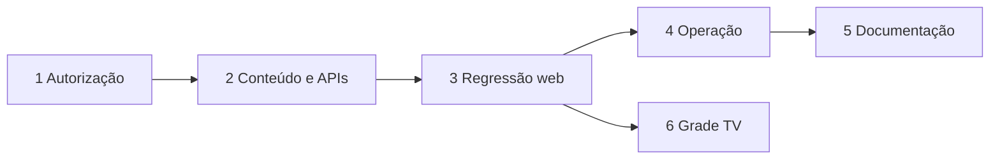

# Roadmap: Segurança e operação do vPlayCast Web

## Fase 1: Modelo de ameaças e autorização

**Objetivo:** tornar verificável a segurança de Auth, proxy, RLS, RPCs e Storage na arquitetura web existente.

**Requisitos:** SEC-01, SEC-02

## Fase 2: Proteção de conteúdo e APIs

**Objetivo:** fortalecer CSP, validação de entradas, uploads, URLs e limites de abuso sem quebrar os fluxos públicos.

**Requisitos:** SEC-03, SEC-04

## Fase 3: Regressão dos fluxos web essenciais

**Objetivo:** preservar painel, telões, overlays, relatórios e páginas públicas com testes de integração por igreja.

**Requisitos:** AUTH-01, AUTH-02, ADM-01, DISP-01, OVR-01, PUB-01, DATA-01

## Fase 4: Confiabilidade operacional

**Objetivo:** validar backup, restauração, migrations, deploy e sinais operacionais do Supabase e do telão.

**Requisitos:** REL-01, REL-02, OPS-01

## Fase 5: Documentação e liberação web

**Objetivo:** manter guias de operação, segurança e deploy alinhados ao comportamento verificado.

**Requisitos:** DOC-01

## Fase 6: Grade TV administrativa

**Objetivo:** oferecer uma visualização administrativa da programação do telão sem duplicar sua lógica, gerar métricas ou alterar o comportamento público.

**Requisitos:** TVG-01

**Critérios de implementação:**

- Rota administrativa protegida por Auth/proxy e sem link público.
- Reutiliza `lib/services/telao-schedule.js`, agenda global, versão do cronograma e horário do servidor como fonte de verdade.
- Mostra oito ciclos por vez e alterna os grupos 1–8, 9–16 e seguintes automaticamente.
- Usa blocos proporcionais à duração e cores determinísticas pelo identificador do patrocinador.
- Mostra detalhes no hover e no toque, sem carregar mídia.
- Destaca o ciclo ativo somente quando a contagem oficial estiver ligada.
- Não cria impressões, visualizações, segundos exibidos ou consultas adicionais por ciclo, hover ou destaque.

## Dependências

---
*Atualizado em 2026-10-22. O roadmap não inclui Electron ou runtime local.*
