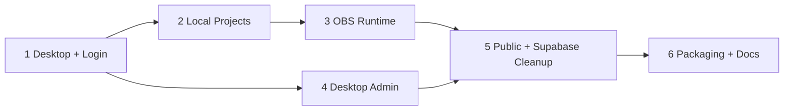

# Roadmap: Desktop Admin and Local Overlays

## Phase 1: Desktop foundation and secure login

**Goal:** Establish a Windows Electron shell with a secure bridge and authenticated administrative session.

**Requirements:** DESK-01, AUTH-01, AUTH-02, AUTH-03, AUTH-04

**Deliverables:** Electron process structure, packaged development workflow, encrypted session storage, Supabase login gate, admin-role guard, logout, security baseline and tests.

## Phase 2: Local overlay projects and editor persistence

**Goal:** Make overlay projects local-first, with UUID folders and durable editor state.

**Requirements:** OVR-01, OVR-02, OVR-03, OVR-04

**Deliverables:** Local project schema, filesystem repository, project creation/duplicate/delete, local media handling, autosave/backup and migration importer from existing overlay exports.

## Phase 3: OBS runtime and instant local updates

**Goal:** Run every local overlay through a loopback URL and reflect edits immediately in OBS.

**Requirements:** OVR-05, OVR-06, RUN-01, RUN-02, RUN-03, RUN-04

**Deliverables:** Loopback HTTP/WebSocket runtime, transparent renderer, stable UUID links, live editor event protocol, file watcher and resilience tests.

## Phase 4: Move online administration to desktop

**Goal:** Make the desktop the only operational interface for sponsors, telões and settings.

**Requirements:** ADM-01, ADM-02

**Deliverables:** Desktop navigation and pages for patrocinadores, ajustes, edição de telões e métricas; Supabase repositories/services compatible with Electron, media upload flows, protected admin actions and regression suite.

## Phase 5: Public-site reduction and Supabase overlay retirement

**Goal:** Keep the hosted app public-only and remove the obsolete remote overlay domain safely.

**Requirements:** PUB-01, PUB-02, PUB-03, URL-01, DB-01, DB-02, DB-03

**Deliverables:** Public-only landing, comunidade, slugs, telões web e relatórios; removed overlay/admin routes and APIs; corrected URL actions by destination; backup runbook, reviewed destructive migration, schema snapshot and Storage cleanup audit.

## Phase 6: Packaging, operations and documentation

**Goal:** Deliver a supportable Windows release with complete operator documentation.

**Requirements:** DOC-01, DOC-02

**Deliverables:** Windows installer/release checks, OBS setup guide, local backup/restore guide, revised README and technical documentation, smoke test and rollback guide.

## Dependency order

