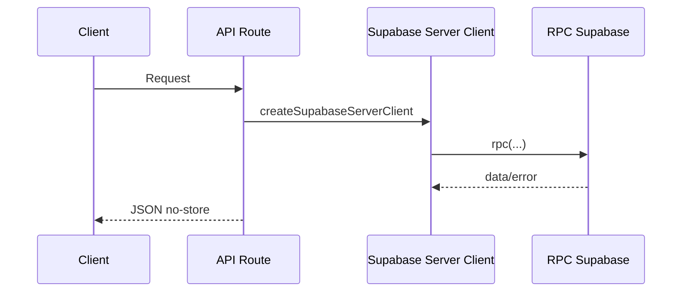

# APIs

> Rotas públicas dependem de uma igreja ativa. Uma igreja desativada não aparece em `/igrejas` nem expõe conteúdo pelo slug.

## Endpoints

| Metodo | Rota                    | Responsabilidade                                         |
| ------ | ----------------------- | -------------------------------------------------------- |
| GET    | `/api/parceiros/:id`  | Detalhe público e logs de patrocinador                   |
| POST   | `/api/parceiros/logs` | Registro de exibições do telão                           |
| GET    | `/api/igrejas`          | Lista igrejas com rota pública ativa                     |
| GET    | `/api/igreja/:slug`     | Dados públicos de uma igreja ativa                       |
| POST   | `/api/admin/invites`    | Envia convite administrativo; exige `x-provisioning-key` |
| GET    | `/api/perfil-paroquia`  | Perfil publico da paroquia                               |

Todas as respostas publicas usam `Cache-Control: no-store`.

## Fluxo



## Logs de Exibicao

Payload unico:

```json
{
  "sponsorId": "00000000-0000-4000-8000-000000000001",
  "displayedAt": "2026-07-13T12:00:00.000Z",
  "durationSeconds": 10,
  "source": "telao"
}
```

Payload em lote:

```json
{
  "logs": [
    {
      "sponsorId": "00000000-0000-4000-8000-000000000001",
      "durationSeconds": 10,
      "source": "telao-master"
    }
  ]
}
```

## Validacoes

- Zod valida logs.
- `source` deve representar `telao` ou `telao-master` no banco.
- Duracao e limitada.
- Rate limit em memoria protege o POST de logs.
- RPC ignora logs quando contador esta desativado, tipo pausado ou patrocinador inativo.

## Status

- `200`: sucesso.
- `400`: payload invalido.
- `404`: patrocinador nao encontrado.
- `429`: muitas requisicoes.
- `500`: falha Supabase/RPC.
