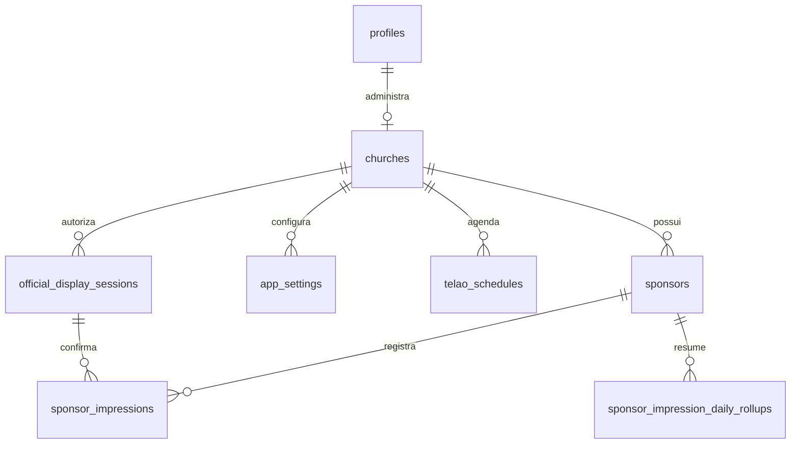

# Banco de Dados

> Fonte de referência: `supabase/schema.sql`. Em bancos existentes, aplique as migrations; não execute o snapshot inteiro sobre uma instalação já criada.

## Entidades principais

- `profiles`: perfil básico do usuário autenticado.
- `churches`: identidade, slug, estado público e administrador de cada igreja.
- `sponsors`: patrocinadores, mídia, tipo, estado e métricas acumuladas.
- `app_settings`: configurações administrativas e de patrocinadores em JSON.
- `sponsor_impressions`: registros individuais de exibição.
- `sponsor_impression_daily_rollups`: totais diários para gráficos e relatórios.
- `telao_schedules`: agenda determinística compartilhada dos telões.
- `official_display_sessions`: sessão autorizada a registrar as métricas oficiais.
- `api_rate_limits`: limites de uso persistidos por hash.

## Relacionamentos

## Tipos e regras

- `sponsor_kind`: `NORMAL` ou `MASTER`.
- `media_type`: `image` ou `video`.
- Patrocinador precisa de nome, mídia válida e duração positiva.
- O slug identifica a rota pública da igreja.
- Impressões usam `event_id` para evitar duplicidade.

## RPCs mais usadas

- `get_public_churches` e `get_public_parish_profile`;
- `get_public_sponsors`, diretório, detalhe e relatório de patrocinadores;
- `get_sponsor_settings`;
- `get_active_telao_schedule` e `open_official_display_session`;
- `log_sponsor_impressions`.

## Proteção dos dados

RLS separa os dados por igreja. Escritas administrativas dependem de `public.owns_church(church_id)` e do usuário definido em `churches.admin_id`. As RPCs públicas retornam somente conteúdo liberado para igrejas ativas.
