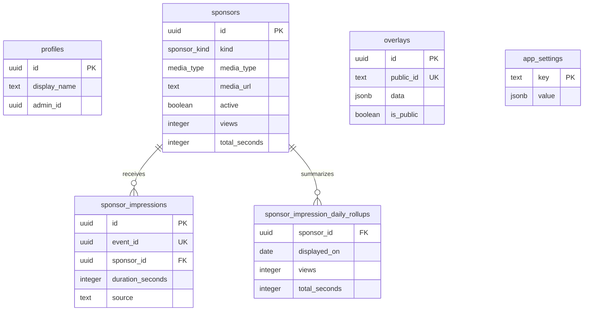
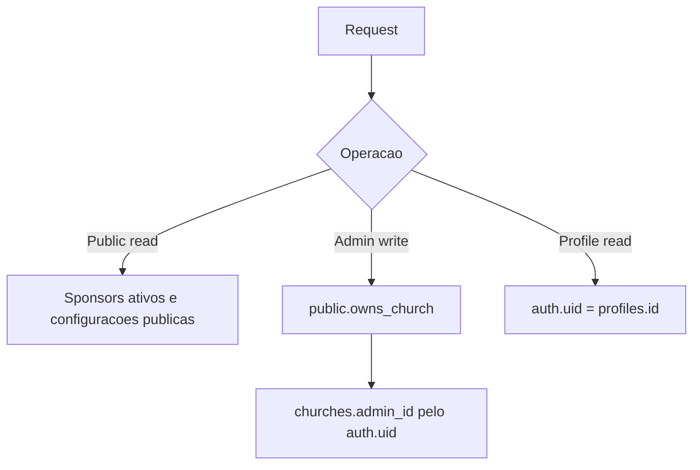

# Banco de Dados

> Snapshot atual: `supabase/schema.sql`. Para bancos existentes, aplique as migrations; não execute o snapshot inteiro sobre um banco já criado.

## Tabelas

- `profiles`: perfil básico do usuário Supabase.
- `churches`: dados, slug, estado público (`is_active`) e o único administrador (`admin_id`).
- `sponsors`: patrocinadores, tipo, midia, status, duracao e metricas.
- `app_settings`: configuracoes JSON (`sponsor_settings`, `admin_settings`).
- `sponsor_impressions`: logs de exibicao.
- `sponsor_impression_daily_rollups`: totais diários compactos para gráficos e relatórios.

## ER

## Enums

## Agenda global do telão

- `telao_schedules` mantém a semente determinística, versão e referência UTC compartilhadas pelo telão público.
- `official_display_sessions` identifica, por token efêmero e dispositivo, o único telão autorizado a registrar métricas.
- `sponsor_impressions.official_display_session_id` preserva a relação de cada registro com a sessão oficial.
- As RPCs `get_active_telao_schedule` e `open_official_display_session` são usadas, respectivamente, para sincronizar a reprodução e iniciar o telão oficial pelo painel administrativo.

- `sponsor_kind`: `NORMAL`, `MASTER`.
- `media_type`: `image`, `video`.

## Constraints e Indices

- Nome de patrocinador nao vazio.
- Duracao positiva.
- Midia obrigatoria e tipo `image`/`video`.
- Dimensoes de overlay positivas.
- Índices em status/tipo de patrocinador, public id, logs por data, `event_id` único e resumos diários.

## RPCs Principais

- `get_public_sponsors`
- `get_sponsor_settings`
- `get_public_sponsor_directory`
- `get_public_sponsor_detail`
- `get_public_sponsor_report` (histórico paginado e série diária agregada)
- `get_public_overlay`
- `get_public_parish_profile`
- `log_sponsor_impressions`

## RLS

## Settings

`sponsor_settings` guarda:

- `metricsEnabled`
- `metricsPaused.NORMAL`
- `metricsPaused.MASTER`
- designs por tipo `NORMAL` e `MASTER`

`admin_settings` guarda duracoes padrao e identidade publica da paroquia.

## Cuidados

- Manter `schema.sql` sincronizado com migrations.
- Revisar RPCs `security definer` ao alterar tabelas.
- Aplicar migrations novas antes do deploy.
- Para a instalação atual, aplicar `supabase/upgrade-sponsor-reporting.sql` antes do deploy. Ela adiciona idempotência por `event_id`, reconstrói os resumos diários e cria a RPC paginada.
- Para bancos existentes, aplique `supabase/upgrade-all.sql` e depois `supabase/upgrade-global-telao-scheduling.sql` antes do deploy.
- O telão oficial depende da migration da agenda global; sem ela, a aplicação informa a dependência em vez de simular ciclos.
