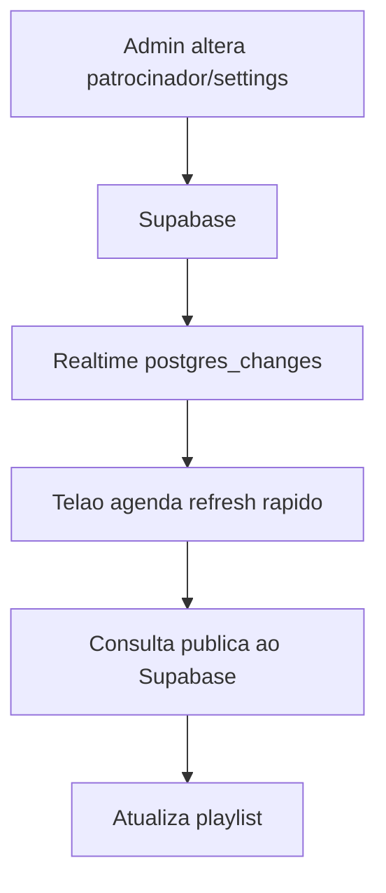

# Cache e Midia

> As mídias do bucket `telao-online-midia` usam o ID da igreja como primeiro segmento do caminho. As políticas de Storage validam esse segmento antes de gravar, alterar ou excluir. URLs já existentes no bucket `v-playcast-midia` continuam compatíveis.

## Objetivo

Documentar como o projeto evita dados velhos e como trata arquivos de midia.

## Cache Atual

As APIs publicas usam `Cache-Control: no-store, max-age=0`. Isso evita que pagina publica, relatorios e telao recebam dados antigos depois de alteracoes no painel.



## Telao Offline

O componente de telao mantem uma copia local da ultima playlist por tipo:

- `telao-online:telao:ads-cache:NORMAL`
- `telao-online:telao:ads-cache:MASTER`

Se a API falhar e houver cache local, o telao continua exibindo a ultima lista conhecida e mostra aviso de cache local.

## Fila de Logs

Quando o contador esta ativo e o POST de logs falha, o player salva os logs em `localStorage` e tenta reenviar quando a conexao volta ou em intervalos periodicos.

Chave local:

```text
telao-online:telao:log-queue
```

## Atualizacao

- Realtime do Supabase atualiza a playlist rapidamente quando `sponsors` ou `app_settings` mudam.
- Um refresh periodico de seguranca roda em intervalo maior.
- A assinatura de playlist considera midia, tipo, duracao, status e settings para evitar re-render sem mudanca real.

## Upload e Midia

- Bucket: `telao-online-midia`.
- Limite: 100 MB.
- Imagens permitidas: GIF, JPEG, PNG, WebP.
- Videos permitidos: MP4 e WebM.
- JPEG/PNG/WebP sao otimizados para WebP no navegador antes do upload.
- GIF e preservado para manter animacao.
- Videos nao passam por transcodificacao.

## Previews

Em cards e listas administrativas, videos/GIFs podem ser renderizados como frame estatico para reduzir distracao e custo visual. No telao, a midia roda conforme configurada.

## Recomendacoes

- Para videos grandes, comprimir antes do upload.
- Preferir WebM para menor tamanho e MP4 para compatibilidade.
- Evitar trocar arquivos mantendo a mesma URL; o storage usa nomes com UUID para cache seguro.
