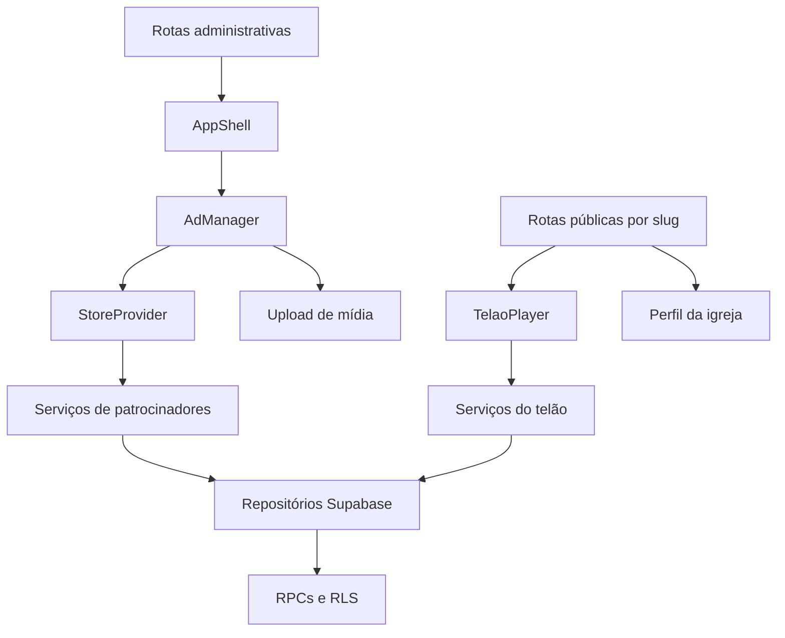

# Componentes, Hooks, Serviços e Providers

## Responsabilidades principais

- `AppShell` e `AppSidebar`: estrutura e navegação do painel administrativo.
- `DashboardContent`: resumo operacional da igreja.
- `AdManager`: cadastro, edição, busca, mídia e ativação de patrocinadores.
- `TelaoPlayer`: agenda pública, reprodução, cache local, realtime e envio de métricas.
- `PaginationControls`: paginação reutilizável das listas públicas.
- `StaticMediaFrame`: prévia estática de vídeos e GIFs nas interfaces.
- `SponsorInterestFloatingCta`: convite flutuante para o formulário de interesse de novos parceiros.

## Estado e acesso a dados

`StoreProvider`, em `lib/store/store.js`, concentra o estado administrativo: patrocinadores, configurações e atualizações da interface. Rotas públicas consultam somente os dados necessários para a igreja ativa.

Os serviços montam payloads e aplicam regras de negócio. Os repositórios concentram consultas ao Supabase e às RPCs; os clientes em `services/supabase/` fazem autenticação, leitura e upload de mídia.

## Serviços relevantes

- dados públicos de patrocinadores, diretório, detalhe e relatório;
- configurações administrativas e da igreja;
- agenda e reprodução do telão;
- upload, otimização e validação de mídia;
- rate limit e registro de exibições.

## Diagrama

## Próximas melhorias

- Extrair hooks para patrocinadores e playlist do telão.
- Manter schemas de domínio para payloads e linhas do banco.
- Dividir componentes administrativos grandes em partes menores e testáveis.
