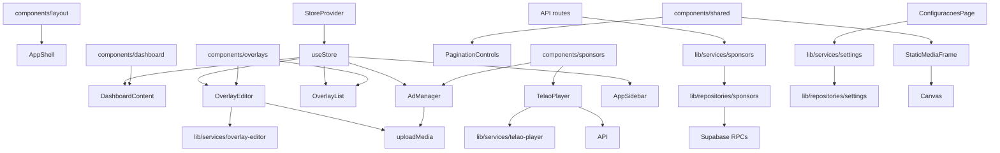

# Componentes, Hooks, Services e Providers

## Atualização multi-igreja

- `lib/services/churches.js` lista igrejas públicas e altera `is_active` para o administrador proprietário.
- `lib/services/provisioning.js` envia o convite; ele não cria a igreja. A igreja é criada pelo administrador em `/configurar-igreja`.
- `services/supabase/admin.js` é exclusivo do servidor e usa `SUPABASE_SERVICE_ROLE_KEY`.
- `services/supabase/upload.js` grava mídia no prefixo da igreja e depende das políticas de Storage.

## Objetivo

Mapear responsabilidades e oportunidades de separacao.

## Componentes de Dominio

- `AppShell`: layout admin desktop e bloqueio mobile.
- `AppSidebar`: navegacao, contadores e logout.
- `DashboardContent`: cards administrativos.
- `AdManager`: CRUD de patrocinadores, filtros, upload e configuracoes de metricas.
- `TelaoPlayer`: playlist publica, cache, realtime, logs e rotacao.
- `OverlayEditor`: canvas, elementos, drag, snap, dialogs, upload e propriedades.
- `OverlayList`: tabela/lista de overlays e preview.
- `CreateOverlayDialog`: criacao de overlay.
- `PaginationControls`: paginacao simples.
- `StaticMediaFrame`: captura frame estatico de video/GIF.

## Provider

`StoreProvider` em `lib/store/store.js` e o provider central de estado. Ele contem:

- defaults de settings;
- mappers de rows Supabase;
- payload builders;
- CRUD de overlays;
- CRUD de sponsors;
- atualizacao de settings;
- notificacao de overlay via `window.dispatchEvent`.

## Services

- `getPublicAdsPayload`
- `getSponsorDirectoryPayload`
- `getSponsorDetailPayload`
- `createSupabaseBrowserClient`
- `createSupabaseServerClient`
- `uploadMedia`
- `optimizeImageForUpload`
- `validateMediaFile`
- `checkRateLimit`
- `getAdminSettings`, `saveAdminSettings`, `resetAdminSettings`, `resetAdministrativeData`
- `getTelaoDefaultDurations`
- `resolveSnapPosition`, `getElementBounds`
- `shuffleArray`, `buildAdsSignature`, `getDesignValue`

## Repositories

- `fetchPublicSponsors`
- `fetchSponsorSettings`
- `fetchPublicSponsorDirectory`
- `fetchPublicSponsorDetail`
- `fetchPublicSponsorImpressions`
- `listOverlays`, `insertOverlay`, `updateOverlayById`, `deleteOverlayById`, `deleteAllOverlays`
- `listSponsors`, `insertSponsor`, `updateSponsorById`, `deleteSponsorById`, `deleteAllSponsors`
- `getAppSetting`, `upsertAppSetting`

## Hooks

- `useIsMobile` em `hooks/ui/use-mobile.js`

## Diagrama

## Melhorias

- Extrair hooks: `useSponsors`, `useOverlays`, `useTelaoPlaylist`, `useOverlayEditor`.
- Criar schemas de dominio para payloads e rows.
- Dividir `OverlayEditor` por toolbar, canvas, properties panel e dialogs.
