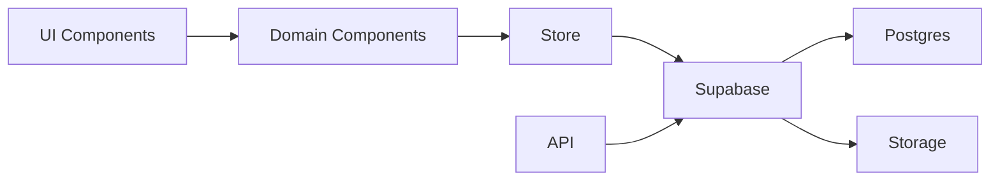

# Convencoes, Boas Praticas, FAQ e Glossario

## Atualização multi-igreja

- Todo conteúdo público usa `/{slug}/...`; não crie novas rotas globais de conteúdo de igreja.
- O único administrador de uma igreja é definido por `churches.admin_id`.
- `is_active` controla a publicação da igreja em `/igrejas` e em suas rotas públicas.
- Não adicione `created_by`, `deleted_by`, soft delete ou restauração sem revisão explícita do modelo de dados.

## Objetivo

Padronizar linguagem e apoiar manutencao.

## Convencoes Propostas

- `Sponsor`: entidade tecnica de patrocinador/anunciante.
- `Overlay`: composicao visual com elementos.
- `Telao`: player publico de exibicao.
- `Settings`: configuracoes persistidas em `app_settings`.
- `Repository`: camada de acesso a dados.
- `Service`: regra de aplicacao/orquestracao.

## FAQ

**Por que o painel nao abre no celular?**  
`AppShell` bloqueia mobile para rotas administrativas.

**Onde ficam as metricas?**  
Em `sponsors.views`, `sponsors.total_seconds` e `sponsor_impressions`.

**Onde ficam as imagens?**  
No bucket Supabase Storage `v-playcast-midia`.

**O que e `public_id`?**  
Identificador público de overlay usado em `/{slug}/shared/:publicId`.

## Diagrama de Dependencias

## Glossario

- RLS: Row Level Security do Supabase/Postgres.
- RPC: funcao SQL chamada pelo client/API.
- Mojibake: texto corrompido por problema de codificacao.
- Turbopack root: raiz inferida pelo build Next/Turbopack.
