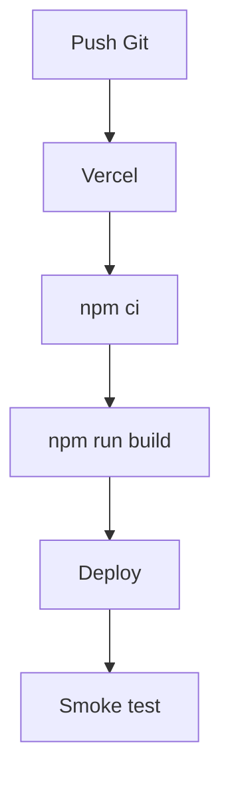

# Deploy, Ambientes e Operacao

Para configurar as variáveis e o redirect de convite, siga [Configuração de ambiente passo a passo](./configuracao-de-ambiente.md).

## Variaveis

```env
NEXT_PUBLIC_SUPABASE_URL=
NEXT_PUBLIC_SUPABASE_ANON_KEY=
NEXT_PUBLIC_SITE_URL=https://seu-dominio.com
SUPABASE_SERVICE_ROLE_KEY=
PROVISIONING_API_KEY=
```

As chaves `NEXT_PUBLIC_*` podem ser usadas no cliente. `SUPABASE_SERVICE_ROLE_KEY` e `PROVISIONING_API_KEY` são exclusivas do servidor. Cadastre `${NEXT_PUBLIC_SITE_URL}/confirmar-convite` e `${NEXT_PUBLIC_SITE_URL}/redefinir-senha` em **Supabase Auth > URL Configuration > Redirect URLs**.

## Vercel



Passos:

1. Configurar variaveis Supabase.
2. Aplicar migrations no Supabase.
3. Garantir usuario admin em `profiles`.
4. Rodar localmente `npm run lint`, `npm run typecheck`, `npm run test` e `npm run build`.
5. Publicar.
6. Fazer smoke test.

## Pipeline GitHub Actions

- **CI** roda em pull requests e pushes para `deploy`, `main` e `master`:
  lint, typecheck, testes e build.
- **CD** roda após push em `main` ou `master` e publica o artefato já validado
  em produção na Vercel. Também pode ser acionado manualmente.

Antes do primeiro deploy, crie o ambiente protegido `production` no GitHub e
cadastre estes secrets no repositório ou nesse ambiente:

```text
VERCEL_TOKEN
VERCEL_ORG_ID
VERCEL_PROJECT_ID
```

Os IDs da organização e do projeto podem ser obtidos com `vercel link`; o
workflow usa `vercel pull`, `vercel build --prod` e `vercel deploy --prebuilt`.
As variáveis da aplicação continuam sendo administradas no ambiente de
produção da Vercel.

## Node

```bash
npm ci
npm run build
npm run start
```

Use process manager externo para manter restart automatico.

## Supabase

Setup esperado:

- Auth habilitado.
- Migrations aplicadas.
- RLS ativo.
- RPCs criadas.
- Bucket `telao-online-midia`.
- Policies de storage aplicadas.

## Backup e Restore

Backup:

- exportar banco Supabase;
- guardar arquivos do bucket `telao-online-midia`;
- guardar variaveis de ambiente fora do repositorio;
- documentar versao/commit em producao.

Restore:

1. Restaurar banco.
2. Restaurar bucket.
3. Reaplicar variaveis.
4. Rodar migrations pendentes.
5. Fazer smoke test.

## Smoke Test

- `/` carrega perfil e patrocinadores.
- `/login` abre e redireciona depois de login.
- `/admin` exige admin.
- `/painel-telao` lista patrocinadores.
- `/{slug}/ads-telao` exibe mídia ativa de uma igreja pública.
