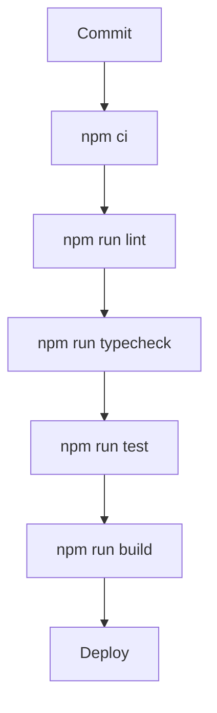

# Build, Deploy e Testes

## Ambiente obrigatório

Copie `.env.example` para `.env` e siga [Configuração de ambiente passo a passo](./configuracao-de-ambiente.md). O build precisa das variáveis públicas do Supabase; o fluxo de convites também precisa das duas chaves privadas em runtime.

## Scripts

```bash
npm run lint
npm run typecheck
npm run test
npm run build
```

## Build

`npm run build` executa Next build e TypeScript. Em alguns ambientes Windows sandbox, workers podem falhar com `spawn EPERM`; nesse caso rode fora do sandbox.

## Lint

`npm run lint` usa ESLint 9 e `eslint.config.mjs`.

## Typecheck

`npm run typecheck` usa:

```bash
tsc --noEmit -p jsconfig.json
```

## Testes

`npm run test` executa Vitest. A cobertura inclui:

- mappers de patrocinadores;
- normalizacao de settings;
- validacao de URLs publicas;
- API routes;
- rate limit;
- upload e sanitizacao de midia;
- helpers do telao;
- fluxos de auth e logs.

## Docker

O repositorio possui `Dockerfile` e `docker-compose.yml`. O fluxo principal
recomendado é Node com `npm run build` e `npm run start`.

## Pipeline Recomendada



## Lacunas Recomendadas

- Testes SQL/RLS em Supabase isolado.
- Testes E2E para login, cadastro de patrocinador e telao.
- Teste visual para dashboards e relatorios mobile.
