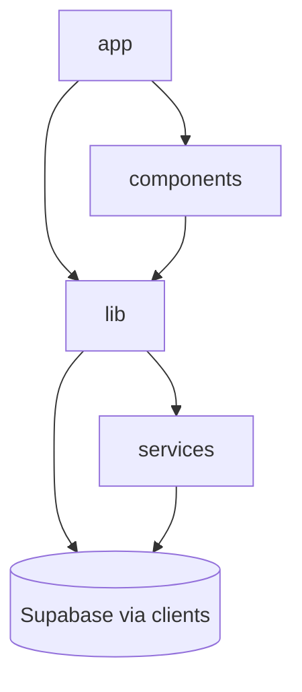

# Estrutura de Pastas

## Atualização de autenticação e igreja

- `app/api/admin/invites/`: endpoint de convite protegido.
- `app/api/igrejas/`: diretório público de igrejas ativas.
- `app/(public)/confirmar-convite`, `esqueci-senha` e `redefinir-senha`: fluxos de Auth.
- `lib/services/churches.js` e `lib/services/provisioning.js`: regras de negócio de igreja e convite.
- `services/supabase/admin.js`: client server-only com service role.

## Inventario

```text
app/                    Rotas Next.js, layouts, paginas e APIs.
components/dashboard/   Dashboard administrativo.
components/layout/      Shell, sidebar e page container.
components/overlays/    Lista, criacao e editor de overlays.
components/settings/    Configuracoes administrativas.
components/shared/      Componentes compartilhados de dominio.
components/sponsors/    Patrocinadores, formulario e telao.
components/ui/          Componentes base Radix/UI.
hooks/ui/               Hooks visuais.
lib/cache/              Rate limit em memoria.
lib/export/             Exportacao XLSX simples.
lib/mappers/            Conversao banco <-> dominio.
lib/repositories/       Acesso Supabase/RPC.
lib/services/           Regras e payloads de aplicacao.
lib/store/              StoreProvider do admin.
lib/utils/              Utilitarios puros.
services/supabase/      Clients Supabase e upload.
supabase/               Schema, migrations, RLS, RPCs e storage.
tests/unit/             Testes unitarios e de rotas.
docs/                   Documentacao tecnica e operacional.
```

## Fluxo de Dependencias



## Regras de Organizacao

- Componentes de tela ficam no dominio correspondente.
- Helpers puros ficam em `lib/utils`.
- Acesso ao banco fica em `lib/repositories`.
- Regras de montagem de payload ficam em `lib/services`.
- Conversoes de nomes e formatos ficam em `lib/mappers`.
- UI generica fica em `components/ui`.

## Refatoracao Recomendada

Quando o projeto crescer, extrair dominios para:

```text
features/sponsors/
features/overlays/
features/settings/
features/public-profile/
```

Cada feature pode conter `components`, `services`, `repositories`, `mappers` e `tests`.
