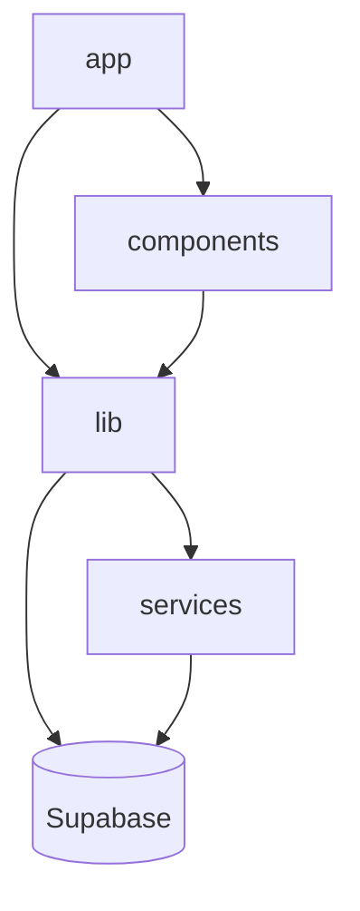

# Estrutura de Pastas

```text
app/                    Rotas, layouts, páginas e APIs do Next.js.
components/dashboard/   Dashboard administrativo.
components/layout/      Shell, sidebar, cabeçalho e contêineres de página.
components/public/      Perfil público da igreja e convite a parceiros.
components/settings/    Configurações administrativas.
components/shared/      Componentes reutilizáveis de domínio.
components/sponsors/    Patrocinadores, formulários e telão.
components/ui/          Componentes base da interface.
hooks/ui/               Hooks visuais.
lib/cache/              Rate limit em memória.
lib/mappers/            Conversão entre banco e domínio.
lib/repositories/       Acesso ao Supabase e às RPCs.
lib/services/           Regras e payloads da aplicação.
lib/store/              Estado administrativo.
lib/utils/              Utilitários puros.
services/supabase/      Clientes Supabase e upload.
supabase/               Schema, migrations, RLS, RPCs e Storage.
tests/unit/             Testes unitários e de rotas.
docs/                   Documentação do produto e da operação.
```

## Dependências



## Regras de organização

- Componentes de tela ficam no domínio correspondente.
- Helpers puros ficam em `lib/utils`.
- Acesso ao banco fica em `lib/repositories`.
- Regras de montagem de dados ficam em `lib/services`.
- Conversões de nomes e formatos ficam em `lib/mappers`.
- UI genérica fica em `components/ui`.

## Direção de crescimento

Se necessário, os domínios podem evoluir para `features/sponsors`, `features/settings`, `features/telao` e `features/public-profile`, cada um com seus componentes, serviços, repositórios e testes.
