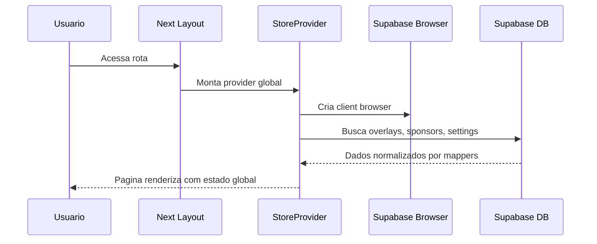
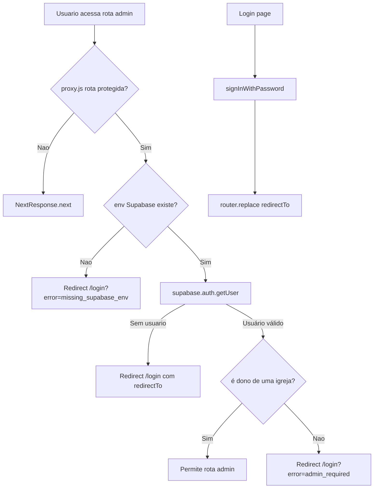
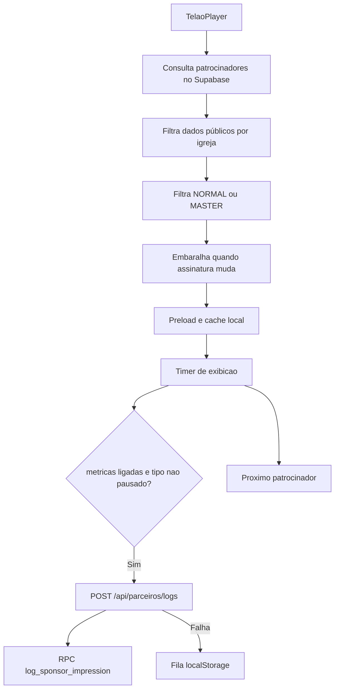
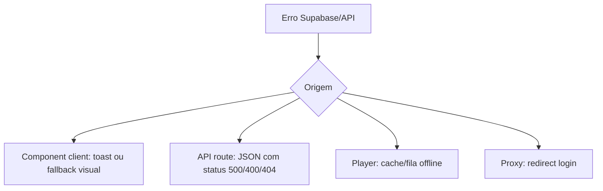
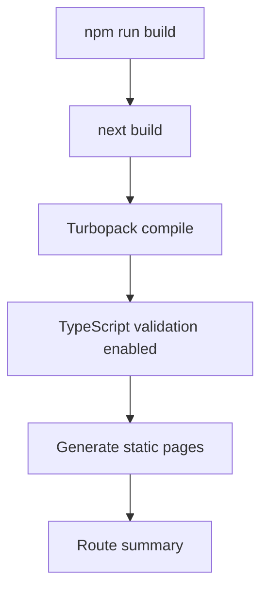

# Fluxos da Aplicacao

> Atualizado em 2026-10: convite → confirmação de senha → configuração da própria igreja é o onboarding administrativo.

## Objetivo

Documentar inicializacao, autenticacao, estado, dados, eventos, erros, build e atualizacoes.

## Inicializacao



## Login



## Player do Telao



## Overlay Compartilhado

```mermaid
flowchart TD
  A[/{slug}/shared/:publicId] --> B[RPC get_public_overlay]
  B --> C[Renderiza elementos visiveis]
  C --> D[Realtime postgres_changes]
  C --> E[Polling 1s]
  D --> B
  E --> B
```

## Tratamento de Erros



## Build



## Observacoes

- O provider global atende o admin e centraliza overlays, patrocinadores e settings.
- O player usa realtime, refresh periodico e cache local.
- Logs offline ficam em fila local e sao reenviados depois.
