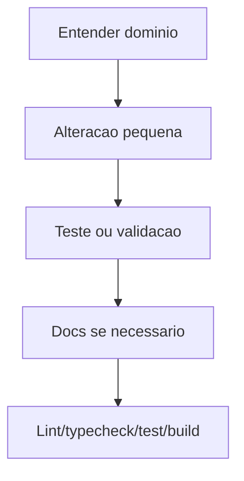

# Guia do Desenvolvedor

Para instalar e explicar cada variável, siga [Configuração de ambiente passo a passo](./configuracao-de-ambiente.md).

## Setup

```bash
npm install
npm run dev
```

Variaveis:

```env
NEXT_PUBLIC_SUPABASE_URL=
NEXT_PUBLIC_SUPABASE_ANON_KEY=
NEXT_PUBLIC_SITE_URL=http://localhost:3000
SUPABASE_SERVICE_ROLE_KEY=
PROVISIONING_API_KEY=
```

Não exponha `SUPABASE_SERVICE_ROLE_KEY` nem `PROVISIONING_API_KEY` em componentes de cliente.

## Rotina de Qualidade

Antes de concluir uma alteracao:

```bash
npm run lint
npm run typecheck
npm run test
npm run build
```

## Padroes

- Use `rg` para buscas.
- Mantenha regras de negocio em `lib/services` quando possivel.
- Mantenha acesso Supabase em `lib/repositories`.
- Use mappers para converter nomes de banco para formato de UI.
- Use `lib/utils` para helpers puros e testaveis.
- Evite adicionar logica grande dentro de componentes ja extensos.
- Atualize docs junto com migrations, rotas e regras de negocio.

## Fluxo de Desenvolvimento



## Supabase

- Para um banco novo, use `supabase/schema.sql`; para bancos existentes, aplique as migrations em ordem.
- Não importe `services/supabase/admin.js` em um componente marcado com `'use client'`.
- Acesse conteúdo administrativo filtrando a igreja do usuário; não use o modelo legado `admin_church_association`.

Ao alterar banco:

- criar migration nova;
- atualizar `supabase/schema.sql`;
- revisar RLS/RPCs;
- documentar em `docs/banco-de-dados.md` ou `docs/seguranca-operacao.md`.

## UI

- Admin e operacional, nao marketing.
- Evite cards dentro de cards.
- Garanta `min-w-0` em grids com graficos/tabelas.
- Admin abaixo de `md` deve exibir bloqueio mobile.
- Midia animada em cards pode usar `StaticMediaFrame`.
