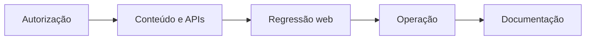

# Roadmap de segurança e operação

Este roadmap consolida os cinco planos de trabalho mantidos anteriormente em `.planning/phases/`. As fases abaixo são evolução planejada: elas não declaram que controles ainda não implementados já estejam concluídos.

## Fase 1 — modelo de ameaças e autorização

**Objetivo:** tornar verificável a segurança de Auth, `proxy.js`, RLS, RPCs e Storage, principalmente o isolamento entre igrejas.

- Mapear rotas administrativas, APIs, tabelas, policies de Storage e RPCs ao mecanismo que as autoriza.
- Criar testes para visitante anônimo, usuário autenticado sem igreja, administrador de outra igreja e administrador proprietário.
- Registrar ativos, fronteiras de confiança, superfícies públicas, riscos aceitos e bloqueios de deploy em `docs/seguranca-operacao.md`.

**Aceite:** não há leitura ou escrita cruzada nos fluxos cobertos; redirecionamentos não são a única defesa; o modelo explica o tratamento de segredos, cookies, mídia, URLs públicas e RPCs `security definer`.

## Fase 2 — proteção de conteúdo e APIs

**Objetivo:** reduzir riscos de conteúdo não confiável e abuso sem quebrar telões, overlays ou patrocinadores.

- Definir CSP compatível com Next.js, Supabase e mídia hospedada.
- Revisar cabeçalhos, cache e origens permitidas em páginas públicas, administrativas e handlers de API.
- Padronizar validação de UUIDs, slugs, URLs, payloads e limites de tamanho antes dos serviços e RPCs.
- Revisar upload de mídia: tipo, tamanho, nome, caminho de Storage e policy por igreja.
- Testar limites de taxa, logs de exibição e erros sem expor credenciais ou dados pessoais.

**Aceite:** CSP validada nas rotas relevantes; APIs recusam entradas inválidas antes de persistir dados; uploads e URLs obedecem regras documentadas e testadas.

## Fase 3 — regressão dos fluxos web

**Objetivo:** proteger contra regressões nos fluxos oferecidos pela web.

- Cobrir login, convite, recuperação de senha, criação de igreja e acesso ao painel.
- Cobrir patrocinadores, mídia, configurações e filtro NORMAL/MASTER.
- Cobrir telão público, sessão oficial, métricas, fila local e relatório público.
- Cobrir criação, edição, publicação e atualização de overlay compartilhado por slug.
- Executar smoke tests das rotas públicas e administrativas após deploy.

**Aceite:** painel, telões, overlays e relatórios funcionam para a igreja proprietária; uma igreja não vê nem altera dados de outra; páginas públicas não expõem dados administrativos.

## Fase 4 — confiabilidade operacional

**Objetivo:** garantir que deploys, scripts SQL, backup e recuperação preservem os dados e os fluxos web existentes.

- Validar backup e restauração do Supabase em ambiente não produtivo.
- Exigir revisão dos scripts SQL, atualização do schema e smoke test antes do deploy.
- Definir sinais para falhas de Auth, APIs, RPCs, Storage e sessão oficial do telão.
- Revisar retenção e privacidade de logs e métricas.
- Documentar rollback sem excluir tabelas, Storage ou overlays utilizados pelo aplicativo.

**Aceite:** uma restauração de teste recupera os dados necessários sem cruzar igrejas; cada alteração SQL possui aplicação, verificação e rollback; observabilidade não registra segredos além do necessário.

## Fase 5 — documentação e liberação web

**Objetivo:** manter os guias operacionais, de segurança e deploy coerentes com o comportamento verificado.

- Revisar README, arquitetura, APIs, banco, segurança, deploy, backup e smoke test contra o código e schema atuais.
- Registrar os fluxos de painel, patrocinadores, telões, métricas, overlays, perfil público e relatórios.
- Remover referências a Electron, aplicativo local, loopback, IPC, instalador Windows e migração de overlays para disco.
- Registrar variáveis de ambiente, limites de acesso e o processo de deploy/rollback.

**Aceite:** a documentação descreve somente a arquitetura Next.js + Supabase em uso; um operador consegue configurar e validar o sistema pelos guias; nenhuma instrução induz a apagar recursos ainda necessários.

## Entrega concluída: Grade TV administrativa

A antiga fase de Grade TV foi entregue. A rota protegida `/grade-ads` reutiliza a agenda em `lib/services/telao-schedule.js`, mostra 11 ciclos com o atual ao centro e mantém a visualização congelada e sem ações quando a contagem está desativada. Os detalhes operacionais estão em [Grade TV administrativa](../atualizacao-futura-grade-tv.md).

## Dependências

