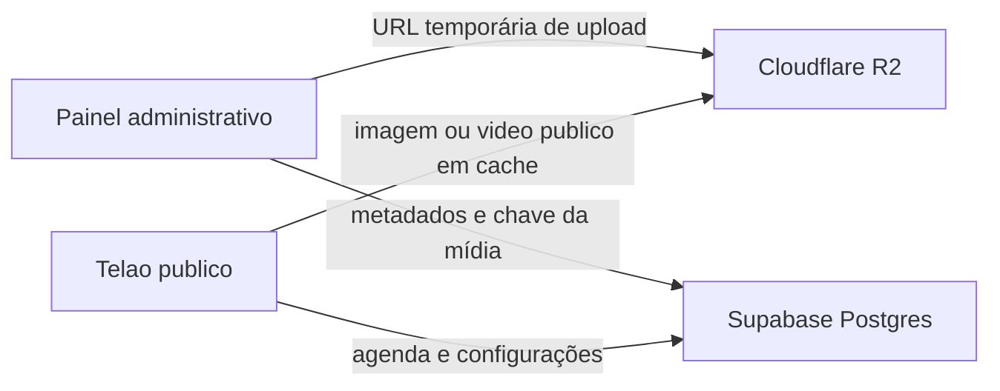

# Plano de integração: Cloudflare R2

## Decisão

Usar o Cloudflare R2 somente para os arquivos públicos de patrocinadores (imagens e vídeos). O Supabase continua sendo a fonte de verdade de autenticação, igrejas, patrocinadores, agenda, configurações e métricas.



Não será incluído Redis, outro banco ou Cloudflare Workers nesta etapa. Eles não resolvem a entrega de bytes de imagem/vídeo e aumentariam a operação.

## Meta de custo

Manter a fatura do R2 em **US$ 0,00**. A faixa gratuita mensal atual contempla 10 GB-mês de armazenamento Standard, 1 milhão de operações de escrita (Classe A), 10 milhões de leituras (Classe B) e transferência de saída sem custo. A faixa gratuita não vale para a classe Infrequent Access, portanto ela não será usada.

Com a estimativa atual de até 200 mídias, cerca de 356 MB armazenados e 500 visitantes/dia assistindo em média cinco minutos, a previsão é cerca de 390 mil leituras mensais. Há margem relevante abaixo das cotas.

> R2 é um serviço por uso: ativá-lo requer assinatura e perfil de cobrança. A meta de R$ 0 é atingida enquanto os limites forem respeitados, mas não existe garantia técnica contra um pico extremo. Alertas e limites de mídia são obrigatórios.

## Fase 1 — configuração da conta (manual)

1. Criar ou acessar a conta Cloudflare e ativar R2 em **Storage & databases > R2**.
2. Criar o bucket `telao-online-media` na classe **Standard**.
3. Criar o subdomínio de produção, por exemplo `media.seudominio.com.br`, na mesma zona Cloudflare da aplicação, e conectá-lo ao bucket.
4. Manter `r2.dev` desativado em produção; ele é destinado a desenvolvimento. O domínio personalizado permite cache e regras de segurança.
5. Criar um token de API R2 limitado a esse bucket, com permissão de leitura e escrita de objetos. Guardar `Account ID`, `Access Key ID` e `Secret Access Key` apenas no cofre do deploy.
6. Configurar CORS permitindo somente as origens da aplicação: produção e `http://localhost:3000` no desenvolvimento.
7. Configurar alertas de custo em US$ 0,01 e US$ 1,00, e revisar semanalmente o painel de uso do R2. Não ativar produtos pagos como Images, Stream, Cache Reserve, Argo ou Workers Paid.

Se ainda não houver domínio próprio, a integração pode ser validada com `r2.dev`, mas o go-live fica pendente do subdomínio. O domínio em si não é fornecido gratuitamente pelo R2.

## Fase 2 — contrato de arquivos e segurança

### Chaves de objeto

Usar nomes imutáveis, sem o nome original do arquivo:

```text
churches/{churchId}/sponsors/{sponsorId}/{uuid}.webp
churches/{churchId}/sponsors/{sponsorId}/{uuid}.mp4
```

Uma alteração sempre gera uma nova chave. Assim o CDN pode manter cache longo sem mostrar versão antiga. Arquivos somente em preparação ficam em `staging/{churchId}/{uuid}` e uma regra de ciclo de vida os remove em 24 horas.

### Regras

- O navegador nunca recebe a chave secreta do R2.
- O endpoint administrativo autentica o usuário e confirma a igreja antes de gerar uma URL de upload temporária.
- A chave é gerada no servidor a partir do `churchId` da sessão; o cliente não escolhe caminho nem igreja.
- Aceitar apenas GIF, JPEG, PNG, WebP, MP4 e WebM; manter o limite atual de 100 MB e retornar erro claro antes do upload.
- As mídias do telão são públicas por natureza. O bucket não deve permitir listagem de objetos, e dados privados nunca devem ser enviados a ele.

## Fase 3 — integração na aplicação

1. Adicionar o cliente S3 compatível no servidor e as variáveis abaixo ao `.env.example`, sem valores reais:

```env
R2_ACCOUNT_ID=
R2_ACCESS_KEY_ID=
R2_SECRET_ACCESS_KEY=
R2_BUCKET=telao-online-media
NEXT_PUBLIC_MEDIA_BASE_URL=https://media.seudominio.com.br
```

2. Criar um serviço de mídia com três operações: emitir URL temporária de envio, montar URL pública pela chave e excluir objeto antigo após troca confirmada.
3. Alterar upload e edição de patrocínio para: validar/cortar a imagem como já ocorre, pedir URL temporária, enviar diretamente ao R2 e somente depois salvar a nova chave no Supabase.
4. Acrescentar ao patrocinador `media_storage` e `media_key` (ou campos equivalentes), preservando `media_url` atual durante a transição. O resolvedor de URL deve aceitar tanto a URL legada do Supabase quanto a chave R2.
5. Quando a gravação no banco for bem-sucedida, excluir a antiga chave R2. Se ela falhar, a regra de ciclo de vida remove o upload temporário.
6. Configurar as respostas públicas com `Cache-Control: public, max-age=31536000, immutable`. Nunca sobrescrever uma chave já publicada.

O upload direto por URL temporária evita que vídeos atravessem o servidor Next.js, reduzindo tempo, memória e consumo do host da aplicação.

## Fase 4 — migração sem interrupção

1. Publicar primeiro o resolvedor que entende Supabase Storage e R2.
2. Migrar uma igreja de teste: baixar, validar hash/tamanho, enviar ao R2, atualizar a referência no banco e testar o telão NORMAL e MASTER.
3. Migrar os demais arquivos em lotes pequenos, com relatório de origem, destino, sucesso e falha.
4. Manter a mídia original no Supabase por sete dias após cada lote como rollback.
5. Somente após a verificação, remover as cópias antigas do Supabase Storage e ajustar a documentação operacional.

## Fase 5 — validação e operação

### Critérios de aceite

- Upload, recorte, preview, troca e exclusão de imagem/vídeo funcionam para a igreja autorizada.
- Um administrador não consegue criar URL ou manipular objeto de outra igreja.
- O telão público carrega as novas mídias pelo domínio `media` e continua atualizando agenda/contagem pelo Supabase.
- A troca de uma mídia não mostra arquivo antigo após o banco apontar para a nova chave.
- A aba de uso do R2 mostra armazenamento abaixo de 10 GB, Classe A abaixo de 1 milhão e Classe B abaixo de 10 milhões no mês.
- Os alertas de custo chegam ao e-mail responsável.

### Rotina mensal

1. Conferir uso e fatura do R2.
2. Conferir objetos `staging` e a execução da regra de limpeza.
3. Verificar se há URLs legadas restantes no Supabase Storage.
4. Revisar arquivos muito grandes e solicitar compressão antes de novos eventos.

## Fora de escopo desta etapa

- Transcodificação de vídeo, streaming adaptativo e Cloudflare Stream.
- Processamento de imagem pago (Cloudflare Images).
- Cache de dados em Redis.
- Arquivos privados, documentos administrativos ou backups no bucket público.

## Referências oficiais

- [Preços e cotas do Cloudflare R2](https://developers.cloudflare.com/r2/pricing/)
- [Primeiros passos e assinatura R2](https://developers.cloudflare.com/r2/get-started/)
- [Buckets públicos e domínio personalizado](https://developers.cloudflare.com/r2/buckets/public-buckets/)
- [Compatibilidade da API S3](https://developers.cloudflare.com/r2/api/s3/api/)
