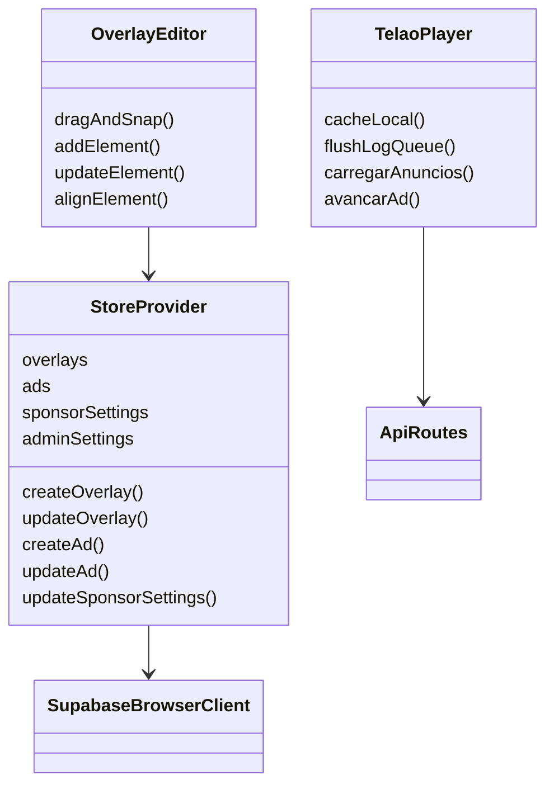
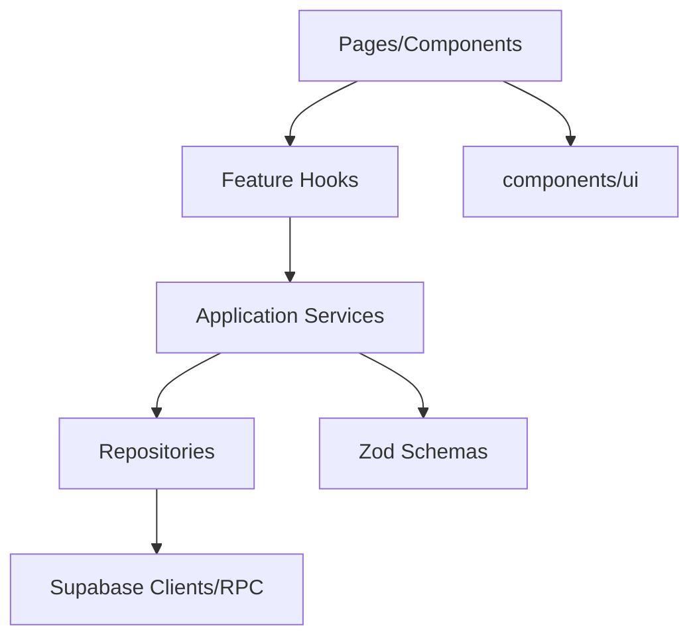
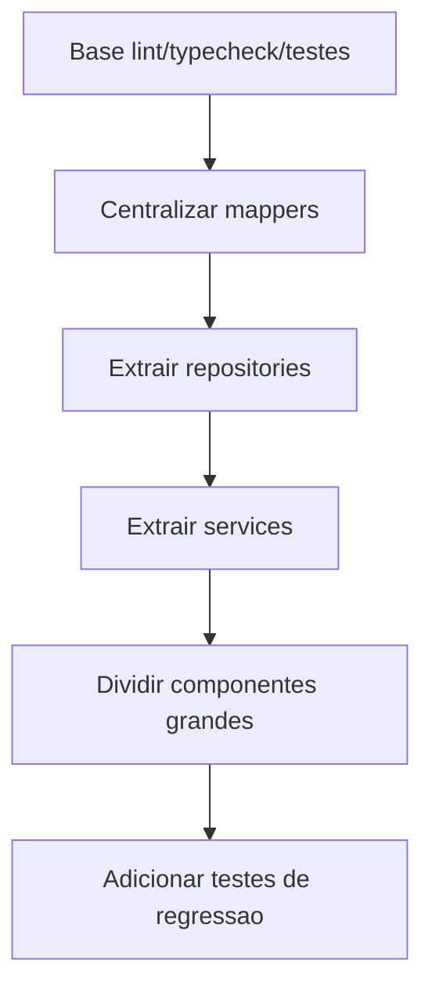

# Revisao Tecnica, Roadmap e Relatorio Final Inicial

## Atualização de outubro de 2026

O Telão Online usa o modelo multi-igreja com um único administrador por igreja, RLS orientada por `church_id`, mídia segregada por prefixo no Storage e exclusão física sem restauração. A raiz abre o único slug ativo ou direciona para `/igrejas`, que lista apenas igrejas com `is_active = true`; ao desativar uma igreja, suas rotas públicas `/{slug}/...` deixam de responder.

## Resumo Executivo

O projeto compila em producao com TypeScript ativo, tem um dominio claro e usa Supabase com RLS/RPCs. Os principais riscos restantes estao em componentes grandes, baixa cobertura de testes de fluxo, dependencia forte do store client-side e falta de documentacao operacional de deploy/backup.

## Arquitetura Encontrada

## Arquitetura Proposta

## Problemas Encontrados

| Severidade | Problema                          | Causa                            | Impacto                                          | Solucao                        |
| ---------- | --------------------------------- | -------------------------------- | ------------------------------------------------ | ------------------------------ |
| Alta       | Componentes gigantes              | UI, estado e persistencia juntos | Baixa manutencao/testabilidade                   | Extrair features e hooks       |
| Media      | Cobertura de testes ainda pequena | Harness criado agora             | Regressao ainda pode escapar em fluxos UI/player | Expandir unit/integration/e2e  |
| Media      | Logs sequenciais                  | Loop RPC por item                | Latencia em lote                                 | RPC bulk ou Promise controlado |
| Baixa      | Docker ausente                    | Nao configurado                  | Onboarding/deploy menos previsivel               | Adicionar Docker opcional      |

## Problemas Corrigidos Nesta Etapa

- Documentacao inicial criada.
- Dependencias instaladas localmente para permitir validacao.
- Build validado.
- ESLint 9 configurado com `eslint.config.mjs`.
- `.env.example` criado.
- `turbopack.root` configurado para remover a inferencia incorreta de root.
- Projeto padronizado para npm.
- `components/ui` usados convertidos para TSX valido; componentes gerados mortos e invalidos removidos.
- `typescript.ignoreBuildErrors` removido.
- Mappers de patrocinadores centralizados.
- Endpoint de logs validado com Zod e rate limit simples.
- Rota `/logout` criada.
- Upload com validacao de tipo e tamanho.
- Vitest configurado com cobertura inicial.
- APIs publicas padronizadas com `no-store`.
- Rate limit de logs mantido em memoria.
- Telao usa realtime, cache local e fila offline de logs.
- Documentacao de deploy, ambientes, backup e restore adicionada.
- StoreProvider passou a usar mappers/repositories para overlays, sponsors e settings.
- `TelaoPlayer` e `OverlayEditor` tiveram logica pura extraida para services testaveis.

## Rodada de Auditoria UI/UX, Performance e Acessibilidade

### Escopo Auditado

- Estrutura App Router com grupos `(admin)` e `(public)`.
- Layout raiz, layout administrativo, sidebar, dashboard, overlays, editor, painel do telao, login, dashboard publico e rotas publicas.
- Store client-side, services, repositories, mappers, Supabase RPC/RLS, upload de midia, cache local do telao e testes Vitest.
- Componentes base de UI (`Button`, `Card`, `Input`), paginacao e preview estatico de midia.

### Rodada Complementar de Julho/2026

#### Escopo Auditado

- Scripts de qualidade: `lint`, `typecheck`, `test` e `build`.
- Fluxos públicos: home pública, busca/lista de patrocinadores, relatório público de anunciante e login.
- Fluxos administrativos: shell/sidebar mobile, painel do telão, toolbar/lista de patrocinadores e formulário de mídia.
- Serviços críticos: normalização de URLs de mídia, player do telão, upload e mensagens de erro.

#### Problemas Encontrados

- A listagem pública de patrocinadores renderizava um link de site dentro do link do card, HTML inválido que pode gerar warning de hidratação e comportamento de clique inconsistente.
- O componente base `Button` não definia `type` por padrão. Em formulários, botões sem `type` podem disparar submit acidental.
- Estados vazios estavam implementados de forma local e visualmente inconsistente entre áreas públicas e administrativas.
- Algumas mensagens operacionais estavam sem acentos, reduzindo polimento e clareza para operadores.
- A validação administrativa aceitava qualquer string iniciada por `/` como URL relativa de mídia, incluindo formas ambíguas como `//host`.

#### Bugs Corrigidos

- Removido o aninhamento de anchors na lista pública de patrocinadores.
- Botões base agora usam `type="button"` quando não recebem `asChild`, preservando `type="submit"` quando explicitamente informado.
- URLs relativas de mídia agora aceitam apenas caminhos internos de barra única, bloqueando `//...` e barras invertidas.
- Mensagens de login, upload, player e exportação pública foram refinadas.

#### Melhorias de UI/UX

- Criado `components/shared/empty-state.js` para padronizar estados vazios com ícone, título, descrição e ação opcional.
- Página pública passou a exibir empty state consistente quando a busca não encontra patrocinadores.
- Painel de patrocinadores passou a usar o mesmo padrão visual para lista vazia e busca sem resultados.
- Link externo do patrocinador foi separado em uma ação própria, mantendo foco, hover e navegação previsíveis.

#### Performance e Segurança

- Não foram adicionadas dependências.
- A mudança de `Button` reduz risco de submits e renders de erro decorrentes de ações acidentais.
- A validação de URL reduz superfície para fontes ambíguas em mídia cadastrada.

#### Validação

- `npm run lint`: aprovado.
- `npm run typecheck`: aprovado.
- `npm test`: 14 arquivos e 49 testes aprovados.
- `npm run build`: aprovado fora do sandbox por exigir spawn de workers do Next/Turbopack.

### Melhorias Implementadas

- `StoreProvider` ficou restrito ao grupo administrativo, evitando consultas administrativas em rotas publicas.
- Dashboard publico passou a consumir apenas dados públicos de patrocinadores.
- A pagina publica principal foi consolidada em `/`, e a rota duplicada `/dashboard` foi removida.
- RPCs publicas de anunciantes passaram a retornar dados apenas de patrocinadores ativos.
- Upload valida tipo e tamanho antes de otimizar imagem, evitando decodificacao desnecessaria de arquivo invalido.
- Sidebar administrativa ganhou controle real de recolher/expandir, com `aria-label` e transicao de margem.
- Dashboard administrativo ganhou acao primaria para criar overlay, aproveitando estado ja existente.
- Componentes base receberam microinteracoes discretas, foco visivel, estado invalido e respeito a `prefers-reduced-motion`.
- Cards foram padronizados para raio de 8px via componente base.
- Paginacao recebeu semantica `nav`, `aria-live`, labels e icones.
- Login recebeu feedback de erro com `role="alert"`, campos marcados como invalidos e loading visual.
- Listas de overlays e patrocinadores reduziram trabalho repetido com memoizacao onde havia filtro/slice/calculos derivados.
- Preview estatico de midia evita atualizar estado quando o tamanho nao mudou e usa carregamento preguiçoso para imagens de preview.
- Mensagens corrompidas da tela de configuracoes foram corrigidas.
- Componentes UI gerados e sem uso foram removidos para reduzir superficie de manutencao.
- Dependencias sem import no codigo atual foram removidas do `package.json` e `package-lock.json`.

### Decisoes Tecnicas

- Nenhuma dependencia nova foi adicionada; as melhorias usam React, Tailwind, Radix/shadcn e lucide ja existentes.
- A limpeza removeu apenas dependencias e componentes sem referencia estatica no app atual.
- Nao houve reescrita de componentes grandes nesta rodada. O foco foi reduzir risco, melhorar consistencia e deixar proximas extracoes mais seguras.
- As regras de negocio do telao, overlays, patrocinadores, metricas e autenticacao foram preservadas.
- A atualizacao do dashboard publico removeu dependencia de dados administrativos diretos; branding publico via `admin_settings` fica como melhoria futura se for exposto por RPC publica propria.

### Performance

- Menos hidratacao/trabalho em paginas publicas pela remocao do provider administrativo global.
- Menos re-render em previews de midia por ignorar eventos de resize sem mudanca efetiva.
- Menos calculos repetidos em dashboards/listas por memoizacao de derivados.
- Upload rejeita arquivos invalidos antes de executar canvas/image decode.

### Acessibilidade e UX

- Foco visual e estados invalidos ficaram mais consistentes nos componentes base.
- Paginacao e controles icon-only receberam labels.
- Erros de login agora sao anunciaveis por leitores de tela.
- Sidebar tem controle explicito de recolhimento.
- Microinteracoes respeitam usuarios com reducao de movimento.

### Divida Tecnica Restante

- `OverlayEditor` ainda concentra muita UI, estado e persistencia em um arquivo grande; recomenda-se extrair hooks de drag/keyboard/dialogs.
- `ConfiguracoesPage` ainda mistura leitura, upload, import/export e renderizacao; recomenda-se separar hooks de settings e backup.
- Rotas publicas de relatorio de anunciante ainda sao publicas por design atual; avaliar link assinado ou token caso os dados de historico sejam sensiveis.
- O dashboard publico perdeu a marca da paroquia por seguranca de dados; criar RPC publica limitada para branding se essa exibicao for necessaria.
- Medicoes de bundle antes/depois ainda dependem de ferramenta de analise dedicada, nao adicionada para evitar dependencia nova.

## Fluxo de Refatoracao Proposto

## Roadmap

1. Padronizar versao Node.
2. Extrair repositories restantes de fluxos administrativos especificos.
3. Dividir `AdManager` e `ConfiguracoesPage` em subcomponentes menores.
4. Ampliar testes de API routes e fluxos criticos.
5. Revisar cobertura de UI/player com testes de integracao.
6. Revisar RPCs `security definer` e considerar RPC bulk para logs.
7. Criar pipeline CI/CD e Docker opcional.

## Checklist Final Desta Fase

- [x] Estrutura auditada.
- [x] Dependencias analisadas.
- [x] Supabase schema/RLS/RPCs analisados.
- [x] Rotas admin, publicas e APIs mapeadas.
- [x] Componentes principais mapeados.
- [x] Build validado.
- [x] Lint configurado e executando.
- [x] Typecheck executando sem erros.
- [x] `.env.example` criado.
- [x] Root do Turbopack fixado.
- [x] Documentacao inicial criada.
- [x] Refatoracao inicial de mappers.
- [x] Testes automatizados iniciais.
- [x] Hardening inicial de logs, logout e upload.
