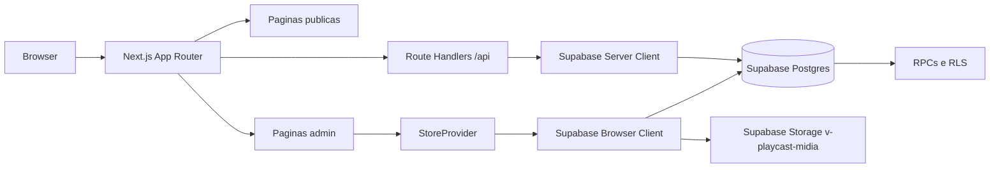

# Visao Geral e Arquitetura

> Atualizado em 2026-10: o sistema é multi-igreja. Cada igreja possui um único administrador (`churches.admin_id`), e a rota pública é controlada por `churches.is_active`.

## Objetivo

Explicar a arquitetura atual do Telão Online e como os domínios principais se conectam.

## Descricao

O Telão Online é uma aplicação Next.js App Router com Supabase para operar patrocinadores, telões e overlays de transmissão. A raiz abre a única igreja ativa ou direciona para `/igrejas`; o painel administrativo é protegido por login e permissão de admin.

## Arquitetura

## Dominios

- Patrocinadores: cadastro, upload de midia, ativacao, playlist e metricas.
- Telao: exibicao NORMAL e MASTER, realtime, cache local e fila offline de logs.
- Overlays: biblioteca, editor visual e links publicos para transmissao.
- Perfil publico: identidade da paroquia, capa, logo e redes sociais.
- Relatorios: historico publico por patrocinador e exportacao XLSX.

## Camadas

- `app`: rotas, paginas e route handlers.
- `components`: UI e componentes por dominio.
- `lib/repositories`: acesso Supabase/RPC.
- `lib/services/churches`: diretório público e ativação da rota da igreja.
- `lib/services/provisioning`: convite administrativo no servidor.
- `lib/services`: regras de aplicacao e montagem de payload.
- `lib/mappers`: conversao entre linhas do banco e formato de tela.
- `lib/store`: provider global usado pelo admin.
- `services/supabase`: clients browser/server e upload.
- `supabase`: schema, migrations, RLS, RPCs e storage.

## Regras Importantes

- Admin nao funciona em mobile.
- Admin exige usuário autenticado que seja proprietário de uma igreja (`churches.admin_id = auth.uid()`).
- Escritas dependem de RLS no Supabase.
- APIs publicas retornam `no-store`.
- Links publicos externos sao filtrados para `http/https`.
- Contador de exibicoes pode pausar NORMAL e MASTER separadamente.

## Direcao de Refatoracao

Manter refatoracoes incrementais e verificaveis. Prioridades futuras:

- extrair dominios para `features/sponsors`, `features/overlays` e `features/settings`;
- migrar regras de dominio para TypeScript gradualmente;
- reduzir o tamanho de componentes grandes como editor de overlay e pagina publica;
- adicionar testes de integracao para RPC/RLS em ambiente Supabase isolado.
