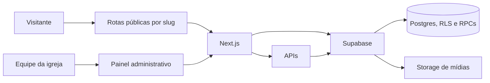

# Visão Geral e Arquitetura

> Atualizado em 2026-10: Telão Online é uma plataforma multi-igreja para patrocinadores e telões.

## Objetivo

Cada igreja administra seus patrocinadores, suas mídias e a programação exibida no telão. O público encontra a igreja pelo slug e pode consultar parceiros e relatórios de exibição.

Ao acessar `/`, a aplicação abre a única igreja ativa. Havendo nenhuma ou mais de uma, direciona para `/igrejas`.

## Arquitetura

## Domínios

- **Igrejas:** perfil público, slug, estado ativo e administrador responsável.
- **Patrocinadores:** cadastro, mídia, período de exibição e página pública de cada parceiro.
- **Telões:** programação NORMAL e MASTER, reprodução pública e sessão oficial para métricas.
- **Relatórios:** registros de exibição e resumo público por patrocinador.

## Regras principais

- Cada igreja tem um único administrador em `churches.admin_id`.
- `churches.is_active` controla a disponibilidade da igreja e de suas rotas públicas.
- O acesso administrativo exige autenticação e autorização no banco.
- Consultas públicas usam apenas dados liberados para a igreja ativa.
- O bucket atual é `telao-online-midia`; a migração para Cloudflare R2 continua planejada para uma etapa futura.
